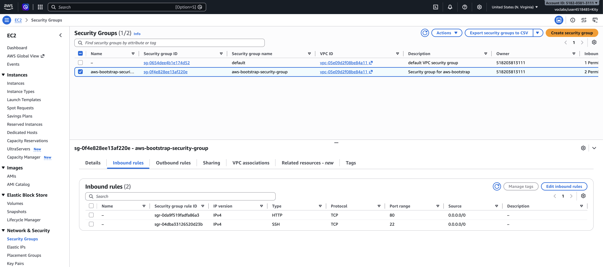
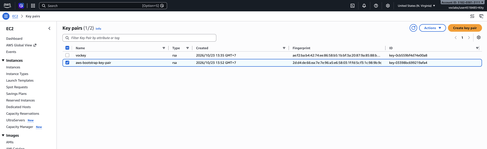
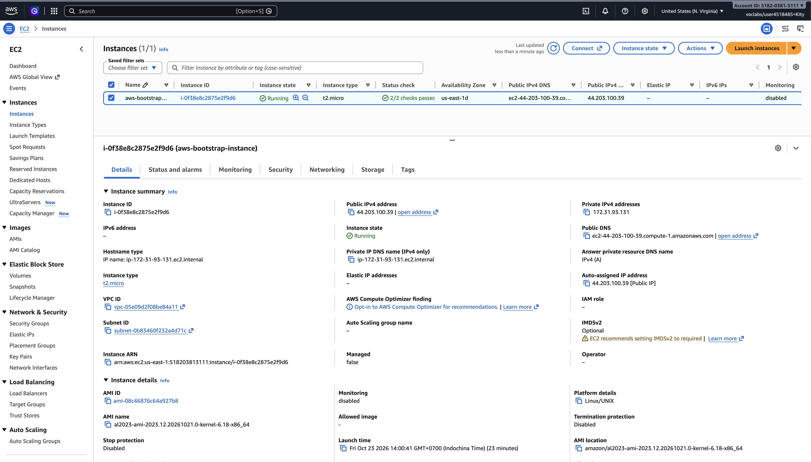
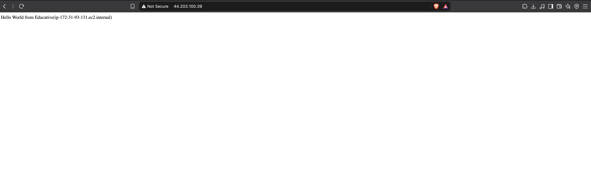
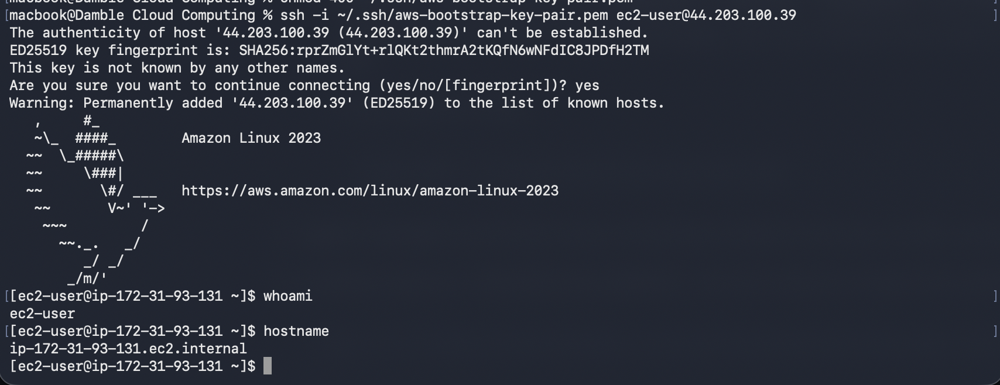
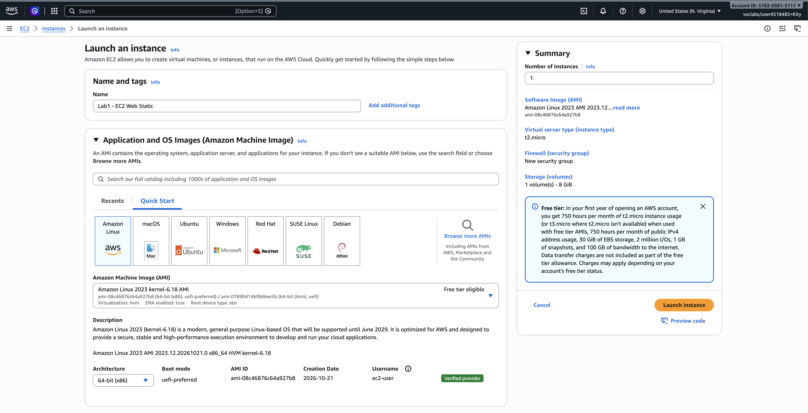
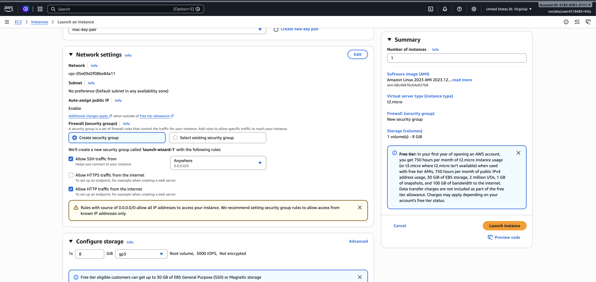
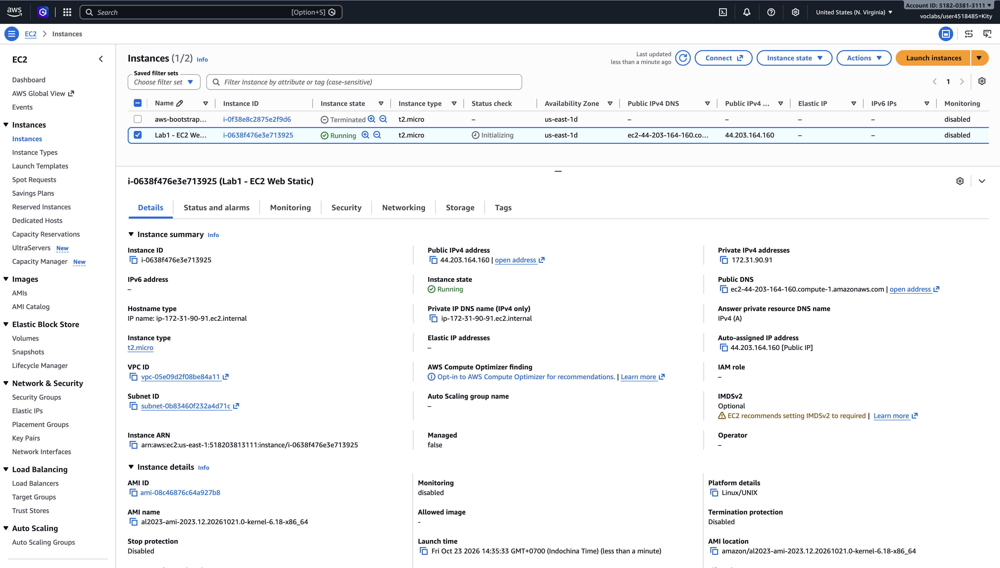
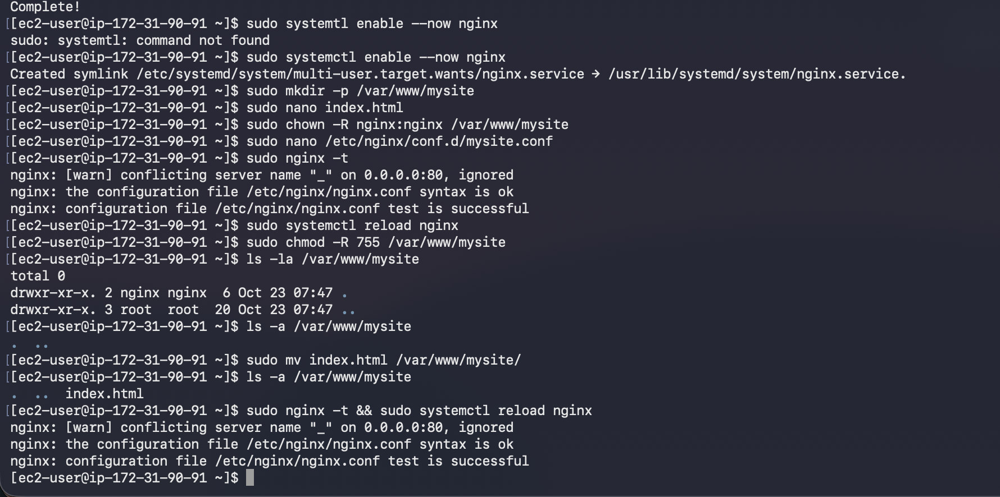
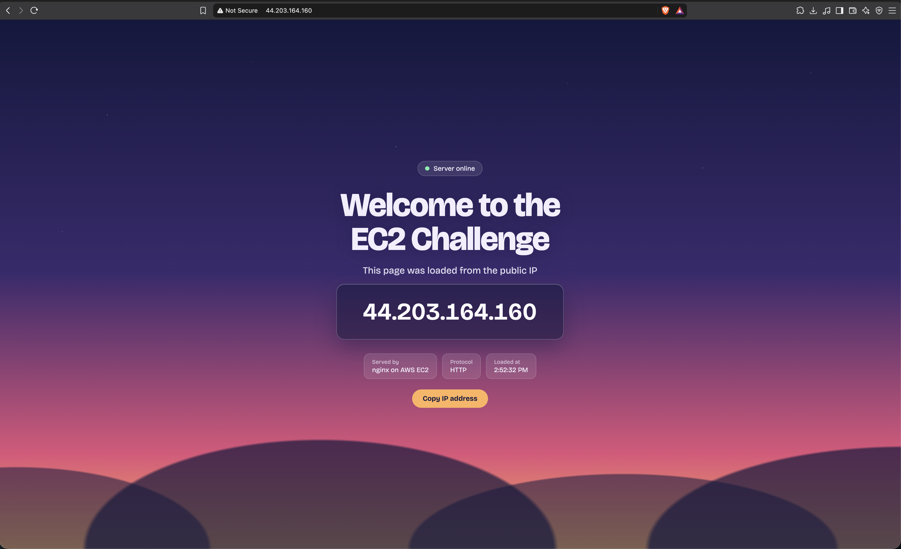

# Cloud Lab 1 Submission — Amazon EC2

Copy this template to `cc-lab-YOUR_ID/lab1/README.md` in your own repository. Follow [the instructions](lab1-instruction.md). Put your screenshots in `lab1/images/` with the file names below.

- **Student name:** Lim Kity
- **Student ID:** e20221479
- **Learner Lab user name:** Lim Kity
- **Date completed:** 23 Oct 2026

---

## Part 1.1 — An Amazon EC2 Walkthrough

### Security group



### Key pair



### Instance details



### Browser test



### SSH connection



Did you connect with your own SSH client or with EC2 Instance Connect?

-> I connected with my own SSH client

---

## Part 1.2 — EC2 Web Solution (Challenge)

### Launch configuration



### Security group



### Running instance



### Commands on the instance



Paste the commands you ran to install the web server and create `index.html`:

```bash
sudo dnf install nginx -y
sudo systemctl enable --now nginx
sudo mkdir -p /var/www/mysite
sudo nano /var/www/mysite/index.html
sudo chown -R nginx:nginx /var/www/mysite
sudo chmod -R 755 /var/www/mysite
sudo nano /etc/nginx/conf.d/mysite.conf
sudo nginx -t && sudo systemctl reload nginx
```

### Browser test



---

## Questions

1. Your security group has an SSH rule and an HTTP rule. What does each one let you do? What would stop working if you deleted the HTTP rule?

   **Answer:** In my security group (`aws-bootstrap-security-group`), the **SSH rule** allows TCP port 22 from `0.0.0.0/0`, so I could log in to the instance from my own terminal with my key pair. The **HTTP rule** allows TCP port 80 from `0.0.0.0/0`, so anyone can open the web page in a browser. If I deleted the HTTP rule, the web page at `http://44.203.100.39` would stop loading (the browser would time out), but SSH would still work.
2. In Part 1.1 you never logged in to install the web server. What installed it, and when did it run?

   **Answer:** The **user data** script provided by the lab, which I pasted into *Advanced details → User data* when launching the instance. EC2 (through cloud-init) runs it once, as root, the first time the instance boots. It installed and started the web server and created the page, which is why the browser shows "Hello World from Educative(ip-172-31-93-131.ec2.internal)" without me logging in.
3. Why does the web page open with `http://` but not with `https://`?

   **Answer:** HTTPS uses port 443. My security group only opens port 80, and the web server has no SSL/TLS certificate configured and does not listen on 443, so only plain HTTP works. That is also why the browser shows "Not Secure".
4. Part 1.2 asked for a 10 GiB root volume. Where in the launch settings did you set it, and how can you check the size on the running instance?

   **Answer:** In the launch wizard, under **Configure storage**, I changed the root volume (gp3) from the default 8 GiB to 10 GiB. On the running instance I can check it with `lsblk` or `df -h /` over SSH, or in the instance's **Storage** tab in the EC2 console.

## Problems and how I solved them (optional)

## AI note (optional)

One suggestion an AI tool gave you and how you checked it.

## Clean up

- [ ] Part 1.1: instance terminated, key pair and security group deleted.
- [ ] Part 1.2: instance terminated, security group (and key pair, if any) deleted.
