# Cloud Lab 2 Submission — Load Balancer and Auto Scaling

Copy this template to `cc-lab-YOUR_ID/lab2/README.md` in your own repository. Follow [the instructions](lab2-instruction.md). Put your screenshots in `lab2/images/` with the file names below.

- **Student name:** LIM Kity
- **Student ID:** e20221479
- **Learner Lab user name:** Lim_Kity
- **Date completed:** 30 Oct, 2026

---

## Security groups

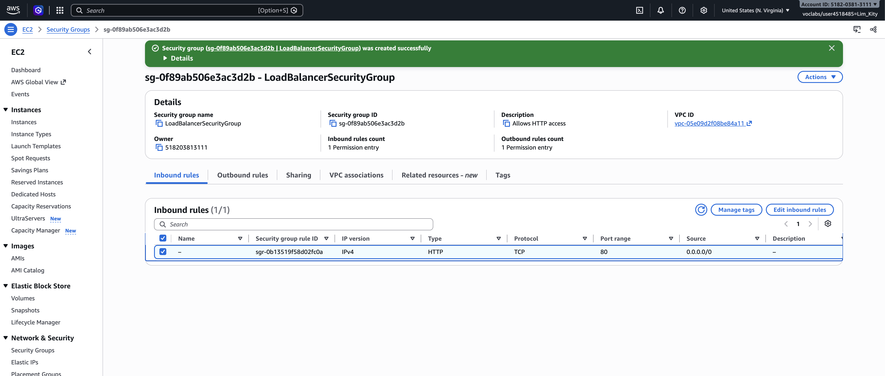

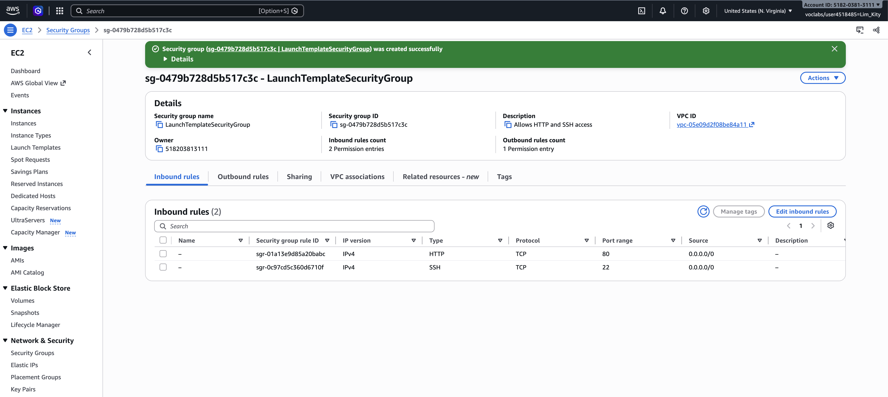

## Target group

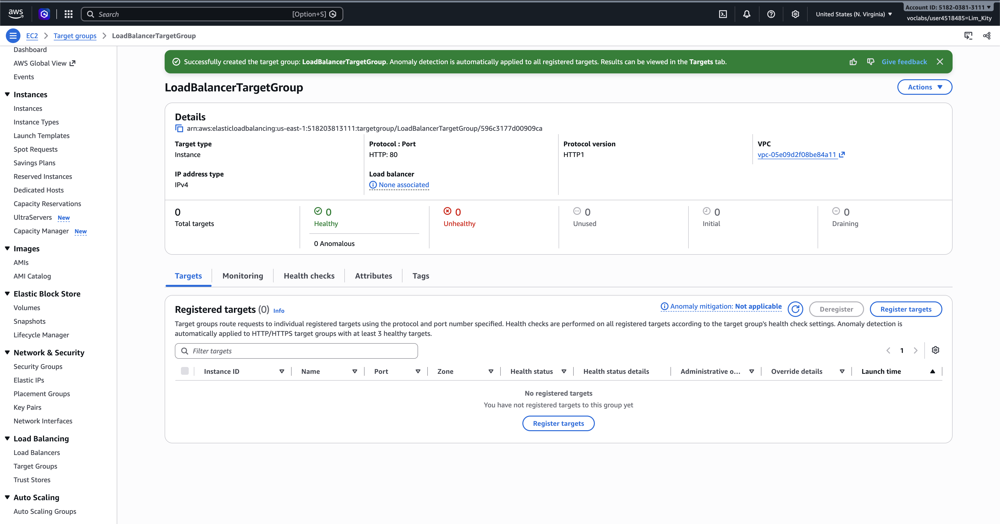

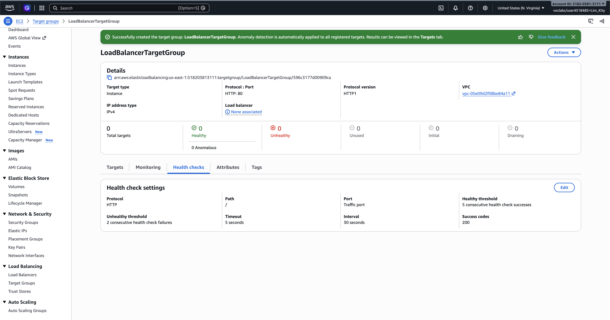

## Application Load Balancer

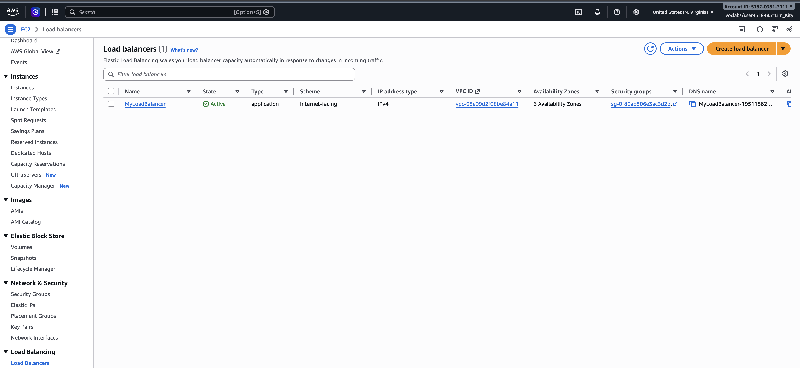

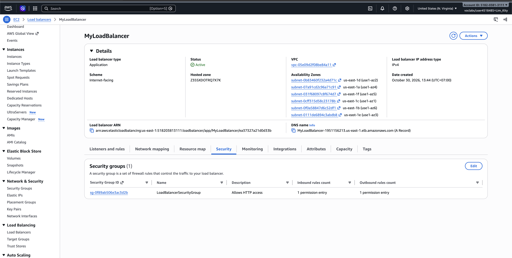

## Launch template

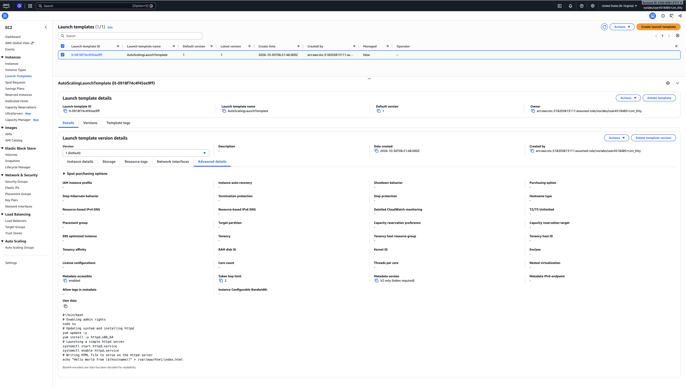

## Auto Scaling group

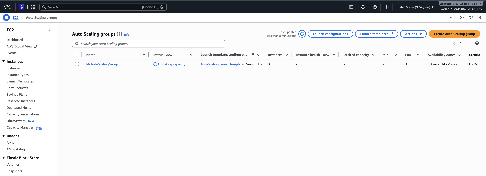

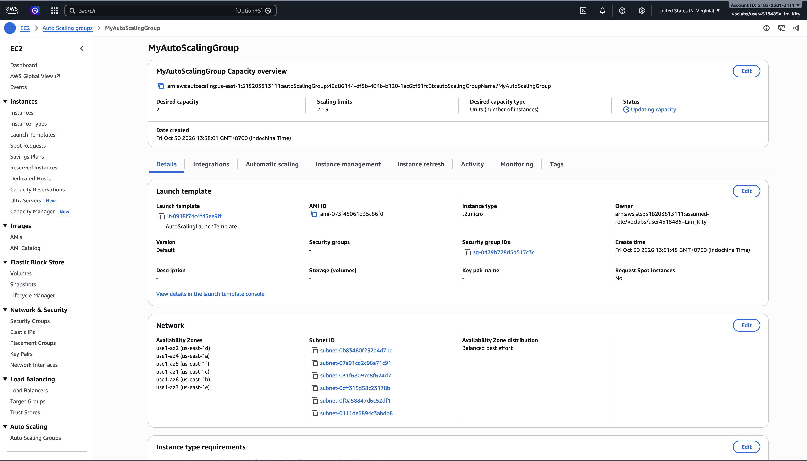

## Load balancing test

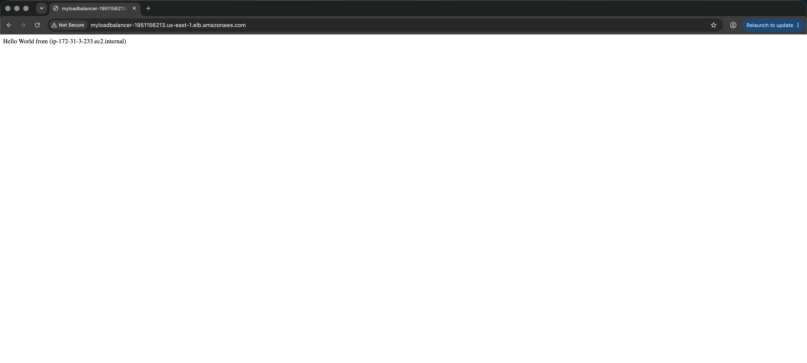

## Simulated application failure

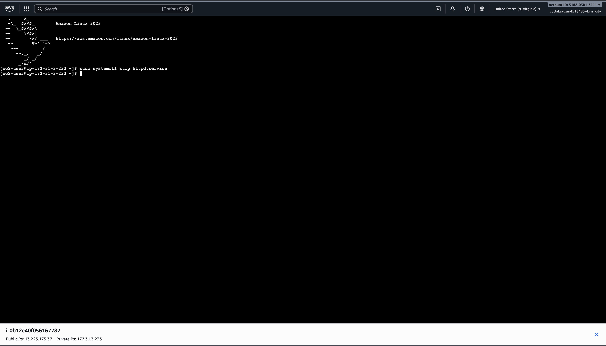

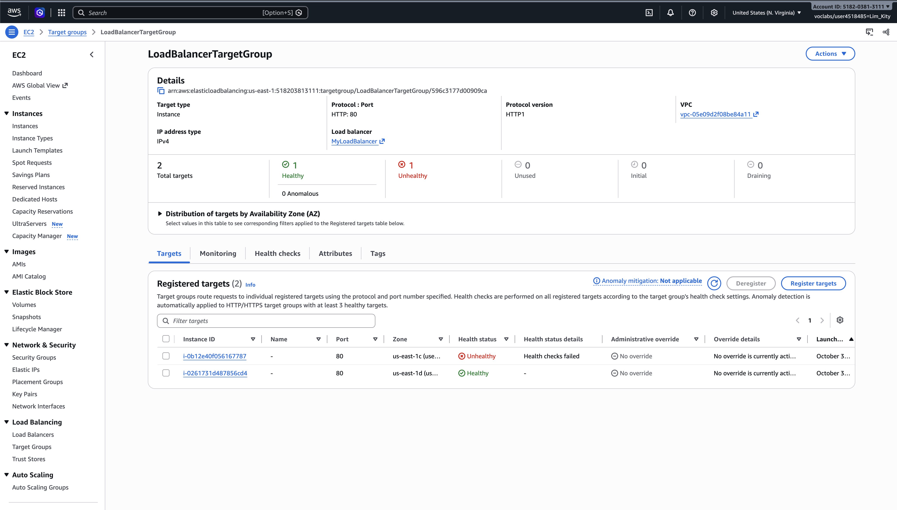

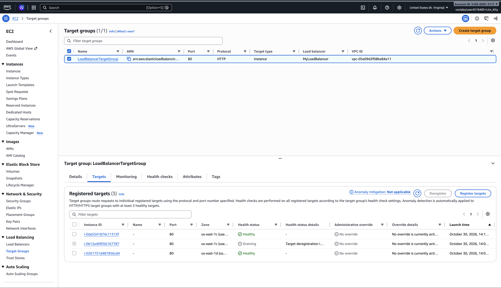

About how many minutes passed between stopping `httpd` and the new instance becoming healthy?
> It takes Around 8-10 mins.
---

## Questions

1. Why does the page show a different host name when you refresh it?
> The load balancer shares requests between the healthy instances, so a refresh can go to a different one. Each instance shows its own host name.

2. After you stopped `httpd`, the instance was still *running* in EC2, but the target group marked it *unhealthy*. What did the health check test, and why did the instance fail it?
> The health check sends an HTTP request to path / on port 80 every 30 seconds and expects a 200 response. Stopping httpd only stopped the web server, not the instance, so EC2 still showed it as running. Nothing could answer on port 80, so the checks failed. After 2 failures in a row, the target group marked it unhealthy.

3. Who replaced the failed instance: the load balancer, the target group, or the Auto Scaling group? Explain the role of each one.
> The Auto Scaling group replaced it.
> - Load balancer: receives requests from users and forwards them only to healthy targets.
> - Target group: keeps the list of instances, runs the health checks and reports their status.
> - Auto Scaling group: keeps the required number of instances running. It terminated the unhealthy instance and launched a new one from the launch template.

4. With desired 2, minimum 2 and maximum 3, how many instances run normally? In what situation could there be 3?
>Normally 2 instances run, because the desired capacity is 2. There could be 3 if a scaling policy or a manual change raises the desired capacity, for example during high traffic. The maximum of 3 means it can't go higher.

5. The instances' security group allows HTTP from anywhere. How could you change it so that the instances accept HTTP **only** from the load balancer?
> Edit the inbound rules of LaunchTemplateSecurityGroup. Delete the HTTP rule with source 0.0.0.0/0, then add an HTTP rule on port 80 with source LoadBalancerSecurityGroup. Users can then reach the instances only through the load balancer, not directly by public IP.

## Clean up

- [✅] `MyAutoScalingGroup` deleted and its instances terminated.
- [✅] `AutoScalingLaunchTemplate` deleted.
- [✅] `MyLoadBalancer` and `LoadBalancerTargetGroup` deleted.
- [✅] Both security groups deleted.
