# Cloud Lab 4 Submission — Amazon VPC

Copy this template to `cc-lab-YOUR_ID/lab4/README.md` in your own repository. Follow [the instructions](lab4-instruction.md). Put your screenshots in `lab4/images/` with the file names below.

- **Student name:**
- **Student ID:**
- **Learner Lab user name:**
- **Date completed:**

---

## VPC and internet gateway

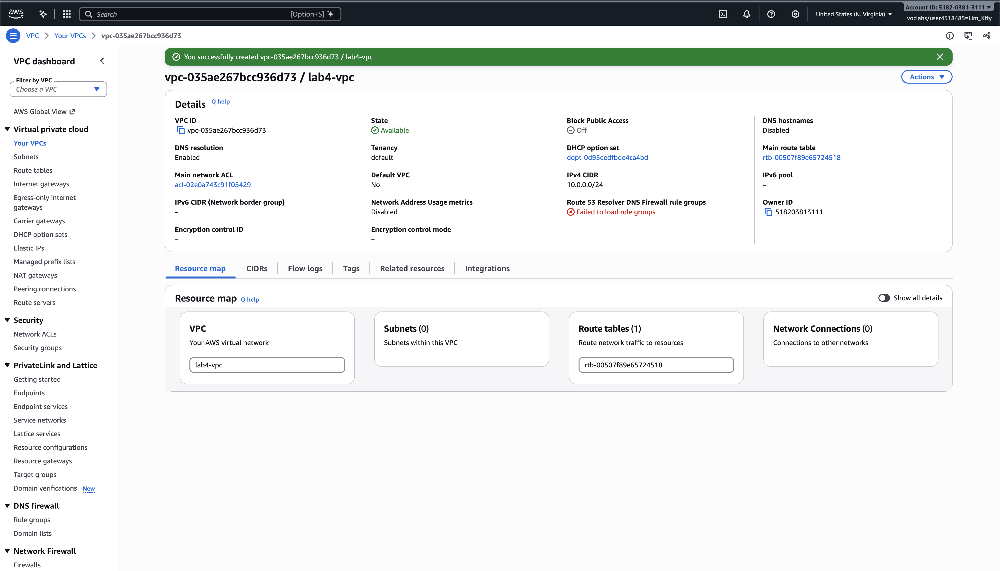

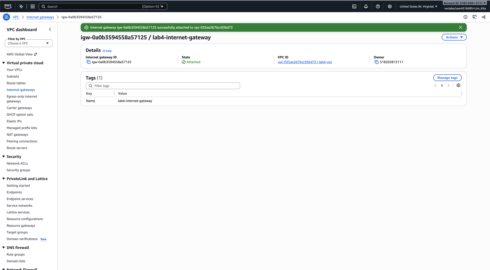

## Public subnet

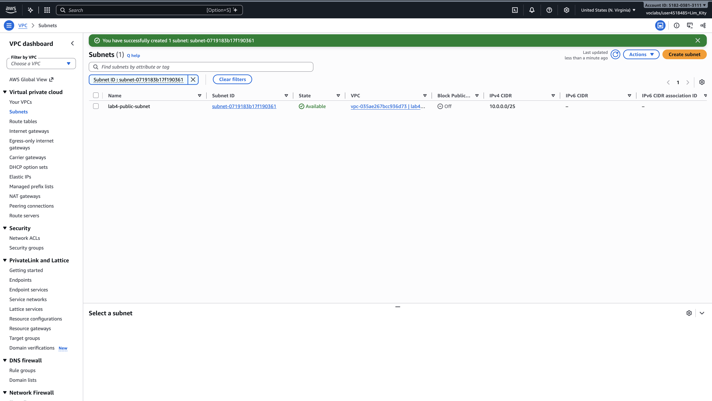

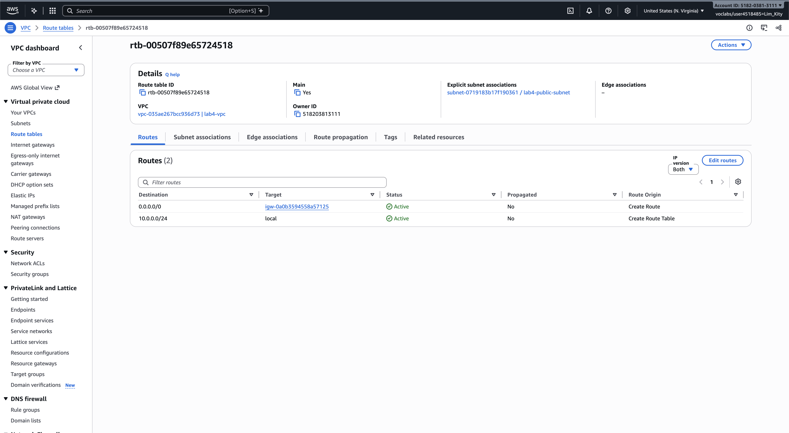

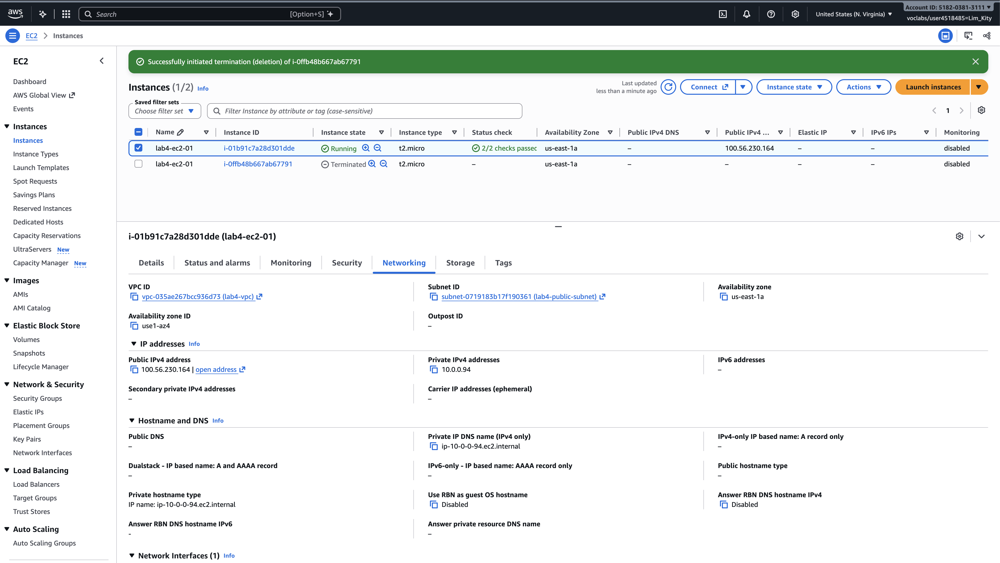

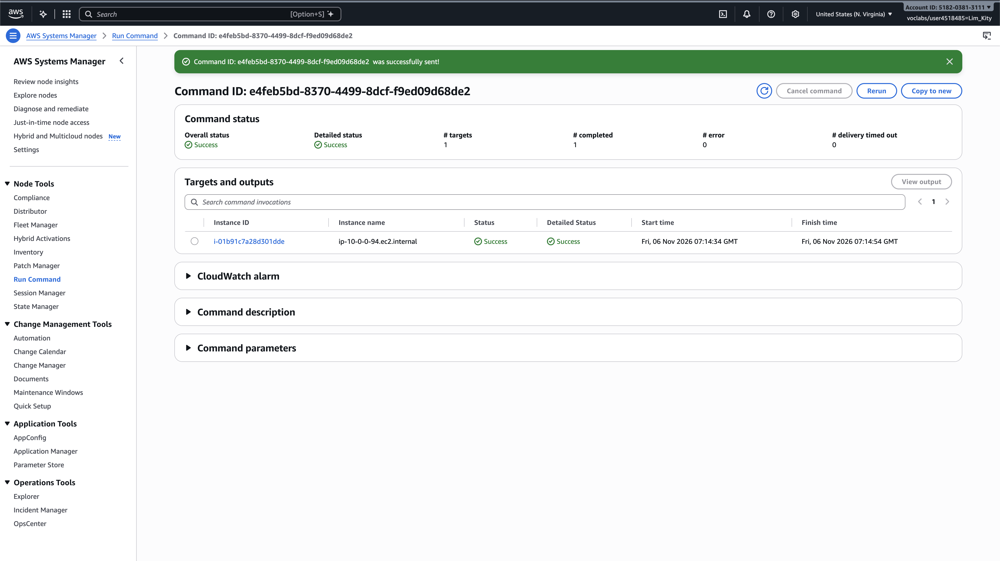

## Private subnet

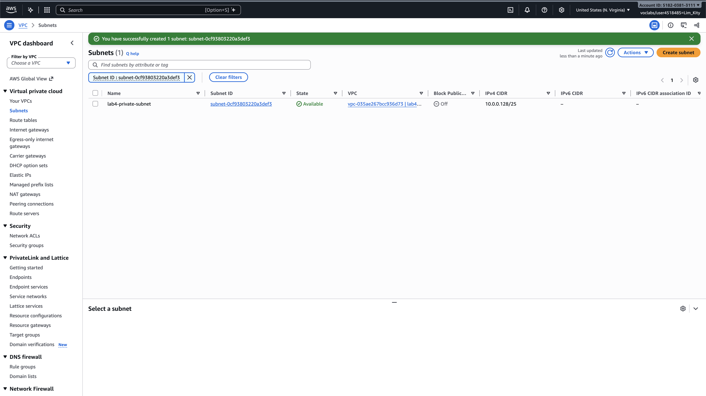

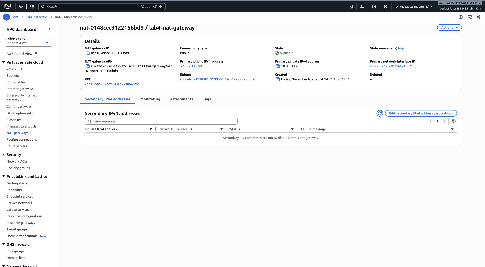

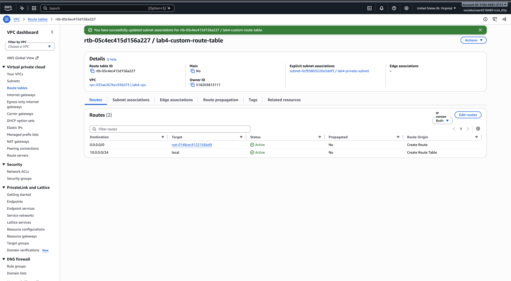

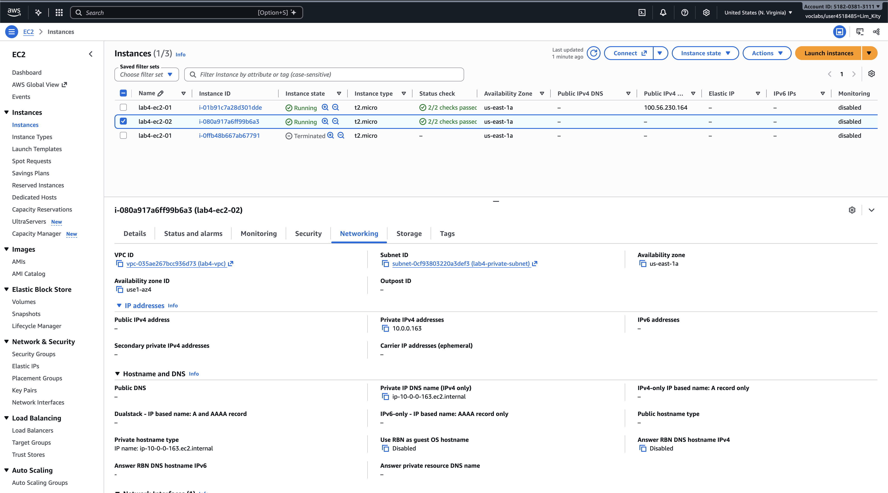

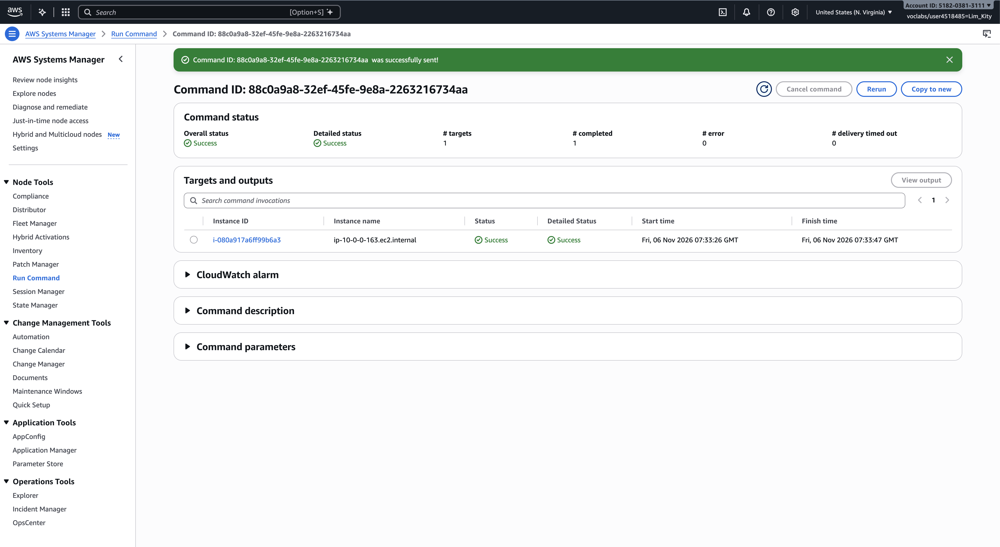

---

## Questions

1. The VPC is `10.0.0.0/24` and the subnets are `10.0.0.0/25` and `10.0.0.128/25`. How many IP addresses does each block contain, and why do the two subnets not overlap?
2. Both subnets are in the same VPC. What exactly makes `lab4-public-subnet` public and `lab4-private-subnet` private?
3. Why is the NAT gateway placed in the **public** subnet and not in the private one?
4. `lab4-ec2-02` has no public IP address. Can someone on the internet open a connection to it? Can it download updates? Explain both answers.
5. You tested internet access with Systems Manager instead of SSH. Why did the instances need `LabInstanceProfile` for this?

### Answers

1. A `/24` has 2^(32−24) = **256** addresses. Each `/25` has 2^(32−25) = **128** addresses. The VPC is split exactly in half: `10.0.0.0/25` covers `10.0.0.0`–`10.0.0.127` and `10.0.0.128/25` covers `10.0.0.128`–`10.0.0.255`. The ranges end and start at different addresses, so no IP belongs to both. (AWS reserves 5 IPs in each subnet, so 123 are usable.)

2. The **route table**. The public subnet's route table has `0.0.0.0/0 → Internet Gateway`, so traffic can go straight to and from the internet. The private subnet's route table has `0.0.0.0/0 → NAT Gateway` instead, so it has no direct path from the internet.

3. The NAT gateway needs to reach the internet itself. Only the public subnet has a route to the Internet Gateway, and the NAT gateway gets a public Elastic IP there. If it sat in the private subnet, it would have no way out to the internet, so it could not forward anything.

4. **No one on the internet can connect to it.** It has no public IP, and the NAT gateway only allows connections that start from inside; it drops new connections coming in. **Yes, it can download updates.** Its outgoing traffic goes to the NAT gateway, which sends it out using its Elastic IP and passes the replies back.

5. Systems Manager works through the SSM Agent on the instance, which calls the Systems Manager service. To be allowed to do that, the instance needs IAM permissions (like `AmazonSSMManagedInstanceCore`). `LabInstanceProfile` gives the instance an IAM role with those permissions. Without it, the instance does not show up in Session Manager and we cannot connect to it.

## Clean up

- [x] Instances terminated.
- [x] NAT gateway deleted and its Elastic IP released.
- [x] Internet gateway detached and deleted.
- [x] `lab4-vpc` deleted.